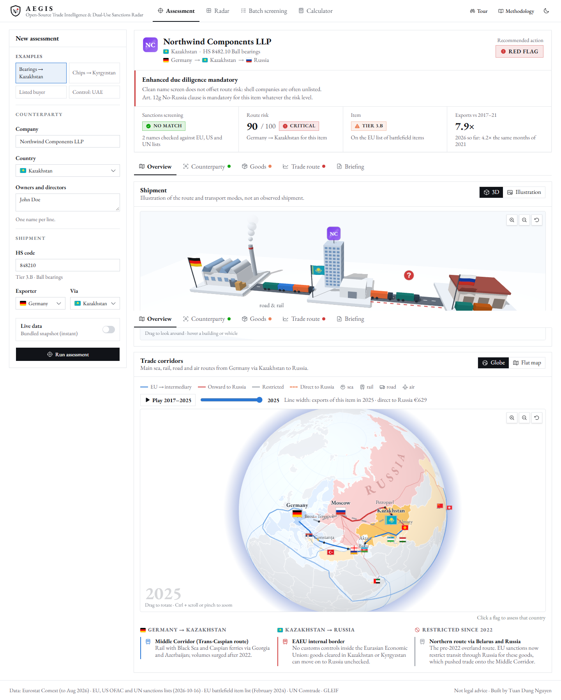

# Aegis

**Open-Source Trade Intelligence & Dual-Use Sanctions Radar.** An open-source (OSINT) tool for EU export-compliance teams and
geopolitical risk analysts: it screens a buyer against sanctions lists, classifies the goods against the
EU's battlefield-item list, and detects anomalous EU exports to third countries that point to
circumvention of the Russia sanctions.

**Live:** https://aegistracker.vercel.app



## What it does

| Module | Question | Method |
|---|---|---|
| **01 Entity & legal screening** | Is the buyer, or its owners, sanctioned? Is the item a battlefield item? | Fuzzy matching (transliteration, legal-form stripping, Levenshtein) against the official EU, US OFAC SDN and UN lists; lookup in the EU Common High Priority Items list (Annex XL to Reg. 833/2014) with indicative Annex I entries of Reg. 2021/821 |
| **02 Transshipment anomaly** | Do EU exports of this HS code to this country behave abnormally since 2022? | Pre-invasion baseline (2017–21), Z-scores, surge multiple, and a displacement check against direct exports to Russia → Transshipment Risk Score 0–100, with adjustable weights and an equal-weights sensitivity check |
| **03 Compliance briefing** | What should the exporter do? | Decision matrix and a one-page briefing: red flags, exposure under the AWG and Reg. 833/2014 (incl. Art. 12g No-Russia clause), enhanced due-diligence steps |

Three views:

- **Radar:** the route score for all 50 battlefield items × 12 intermediary countries (600 corridors) as a 3D
  risk skyline and a heatmap, the highest-risk corridors as cards, and click-to-assess.
- **Assessment:** one buyer, item and route: a result summary with the recommended action, then tabs for the
  counterparty, the goods, the trade route and the written briefing. Each result has its own link (Copy link), so it can be shared
  or bookmarked.
- **Batch screening:** paste or upload a CSV of up to 200 counterparties; download the results.
- **Calculator:** edit yearly export figures (or start from an assessment) and watch the route score and the
  recommended action update, using the same formulas as the assessment.

Extra signals in each assessment:

- **Monthly pulse:** monthly Eurostat exports since 2019, so this year's surge shows about two months behind real
  time (e.g. German bearings to Kazakhstan, January–August 2026: 4.2× the same months of 2021).
- **Price per kg:** value ÷ net mass before and after 2022; a 2× shift is flagged.
- **Mirror check:** what the intermediary itself reports to UN Comtrade (imports from Germany, exports to Russia).
- **Flow diagram:** Germany → each intermediary → Russia, from both sides' reported trade.
- **Company register:** a GLEIF (LEI) lookup for incorporation date, status and ultimate parent; post-invasion
  incorporation is flagged.

Plus a guided tour, a light/dark theme and illustrations of each item type (microchips, bearings, routers, optics,
CNC machines…).

3D views (three.js, drag to rotate):

- **Corridor globe:** the freight corridors on a 3D globe, with moving shipments, flags to click and the export
  time-lapse; a flat map is one click away.
- **Risk skyline:** one bar per corridor on the Radar, height and colour = route score; a top view turns it into the
  heatmap.
- **Months × years:** monthly exports as a 3D landscape (one row per year), with direct exports to Russia beside them
  and a plane at the pre-war μ + 2σ level that flagged months break through.
- **The item in 3D:** a rotatable model of the item family (17 generic models, from microchips to CNC machines) with
  named parts.
- **Shipment diorama:** the exporter's factory, the buyer's site (with its generated company mark) and a Russian
  depot, with ships, truck convoys or cargo planes on each leg and the suspected onward route marked.
- **Link analysis:** the buyer and its owners, the EU, US and UN lists, and every listed name that matched; link colour
  and thickness show name similarity, and listed names open the official record.
- **Batch risk cube:** each screened counterparty as a point by sanctions-match score, route score and item tier, with
  the STOP and HOLD zones shaded; click a point to open its assessment.

The dashboard opens with the shipment route as a 3D diorama (or a flat illustration): the exporter's factory, the typical freight mode
(container ship, truck or cargo plane, with containers scaled to the post-2022 surge), the buyer's compound
with a generated company mark and country flag, and the possible onward leg to Russia. It is schematic, not an
observed route, and the company marks are generated monograms rather than real logos.

Below it, a freight-corridor globe (or flat map) draws the main routes: the Suez and Cape of Good Hope sea
lanes, the Middle Corridor across the Black Sea and Caspian, the Balkan and Black Sea coast roads, and the
onward links to Russia (EAEU border, Upper Lars, the Caspian coast road, the North–South corridor via Iran,
the Black Sea to Novorossiysk, the Manzhouli rail crossing and direct flights from Dubai and Belgrade), plus the
pre-2022 northern route that sanctions now restrict. Ships, trains, trucks and planes move along the routes for
the selected country; clicking another country's flag re-runs the assessment for it. A time-lapse (2017 to the
latest year) scales every route by the item's export volume and shows direct exports to Russia shrinking.

### Route risk is not entity risk

A country-level surge proves that a corridor is being used, not that a given buyer is involved; treating it
as proof would be an ecological fallacy. The two scores are therefore shown and reasoned about separately:
a sanctions match stops the deal, and a critical route requires enhanced due diligence **even when the name
screen is clean**, because new shell companies are rarely listed. Full method in the in-app
*Methodology* dialog.

## Architecture

Next.js (App Router) frontend and a FastAPI backend, deployed together on Vercel: the frontend as static
pages, the backend as one Python serverless function serving every `/api/*` route.

```
├── app/                    Next.js pages, layout, global styles
├── components/             Dashboard, charts (Recharts), panels; ui/ = shadcn/ui
│   └── three/              3D views (three.js): globe, skyline, monthly landscape, item models, diorama,
│                           link analysis, batch risk cube
├── lib/                    API client, types, formatting
├── api/
│   ├── index.py            FastAPI app (Vercel Python function)
│   ├── _lib/               Modules (underscore = not exposed as functions)
│   │   ├── hs_codes.py     CHPL / dual-use classification
│   │   ├── sanctions.py    Fuzzy screening (optional OpenSanctions API)
│   │   ├── names.py        Transliteration and name normalisation
│   │   ├── trade.py        Eurostat → UN Comtrade → snapshot fetch chain
│   │   ├── eurostat.py     Eurostat Comext client (JSON-stat)
│   │   ├── anomaly.py      Z-scores, route score, weight sensitivity
│   │   ├── jurisdiction.py Exposure from facts and designation counts
│   │   ├── mirror.py       Mirror statistics and flow diagram data
│   │   ├── radar.py        All-corridor score matrix
│   │   ├── registry.py     GLEIF company-register lookup
│   │   ├── memo.py         Decision matrix and briefing
│   │   ├── cache.py        In-memory + Upstash Redis cache
│   │   └── config.py       Countries, exposure profiles, settings
│   └── _data/              Bundled datasets (demo mode and fallbacks)
├── scripts/build_cache.py  Rebuilds the bundled datasets
├── tests/                  Backend tests (pytest)
├── .github/workflows/      Monthly data refresh
├── vercel.json             Routes /api/* to the Python function
└── requirements.txt        Python dependencies (kept small for cold starts)
```

The statistics use the Python standard library rather than pandas/NumPy/SciPy, which keeps the function
bundle small and cold starts fast. Every external call has a timeout and a fallback, so the app never
depends on a third-party API being up.

## Data

All bundled data comes from official publishers: Eurostat and the European Commission (free reuse with
attribution), the US Treasury (public domain), the UN Security Council, and a small UN Comtrade extract for the
mirror check (UN Statistics Division, subject to its terms of use). No aggregator licence applies.

- **Trade:** [Eurostat Comext](https://ec.europa.eu/eurostat/web/international-trade-in-goods/database)
  (DS-045409, EUR): exports of all 50 Common High Priority Items from Germany and the EU-27 to 12 intermediary
  countries plus Russia and Belarus, 2017–2025. Exporter-reported data is used because intermediaries
  under-report onward flows. Live mode calls Eurostat (one request, about 3 s) for any listed EU exporter, with
  UN Comtrade as a fallback.
- **Sanctions:** the official lists, not an aggregator: the
  [EU Consolidated Financial Sanctions List](https://data.europa.eu/data/datasets/consolidated-list-of-persons-groups-and-entities-subject-to-eu-financial-sanctions),
  the [US OFAC SDN List](https://sanctionssearch.ofac.treas.gov/) (public domain) and the
  [UN Security Council Consolidated List](https://main.un.org/securitycouncil/en/content/un-sc-consolidated-list),
  about 24,000 persons and organisations.
- **Monthly trade and weights:** Eurostat Comext monthly series since January 2019 and annual net mass.
- **Mirror statistics:** [UN Comtrade](https://comtradeplus.un.org/), as reported by each intermediary (USD).
- **Company register:** [GLEIF](https://www.gleif.org/) LEI records, queried live (CC0).
- **Jurisdiction exposure:** EAEU membership and land borders with Russia (verifiable facts) plus the number of
  organisations in each country designated under Russia/Belarus programmes, counted from the lists above.
- **Items:** European Commission, *List of Common High Priority Items* (February 2024).
- **Flags:** [flag-icons](https://github.com/lipis/flag-icons) (MIT), copied to `public/flags` by `npm run flags`.
- **Basemap:** [world-atlas](https://github.com/topojson/world-atlas) (Natural Earth, public domain), drawn with d3-geo.
- **3D:** [three.js](https://threejs.org/) (MIT).

`scripts/build_cache.py` rebuilds everything; the GitHub workflow runs it monthly.

## Run locally

Requirements: Node.js 20+ and Python 3.12+.

```bash
npm install
python -m venv .venv
.venv\Scripts\pip install -r requirements-dev.txt   # macOS/Linux: .venv/bin/pip
npm run dev                     # web on :3000, API on :8000 (uses .venv)
```

Open http://localhost:3000. API docs: http://localhost:8000/api/docs. Tests: `npm test`.

## Deploy to Vercel

1. Push the repository to GitHub and import it on [vercel.com](https://vercel.com/new). The Next.js preset is
   detected automatically; `api/index.py` becomes a Python function.
2. Optionally add the environment variables from `.env.example`.

| Variable | Effect |
|---|---|
| `COMTRADE_API_KEY` | Free UN Comtrade key: faster fallback if Eurostat is unavailable |
| `OPENSANCTIONS_API_KEY` | Screening via the OpenSanctions `/match` API instead of the bundled lists (their licence terms apply) |
| `UPSTASH_REDIS_REST_URL`, `UPSTASH_REDIS_REST_TOKEN` | Shared cache for live responses |
| `LLM_BASE_URL`, `LLM_API_KEY`, `LLM_MODEL` | Optional analyst narrative in the briefing from any OpenAI-compatible endpoint; legal text always comes from fixed rules |

## Limitations

Annual, country-level trade data cannot see individual shipments or end users, and it lags 6–12 months.
Legitimate demand also grew after 2022. Designation counts reflect where enforcement has looked so far, not
only where evasion happens. Name screening misses unlisted shells and nominee owners. This is an analytical
tool, not legal advice.

---

Built by Tuan Dung Nguyen.
